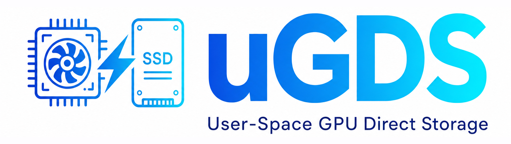
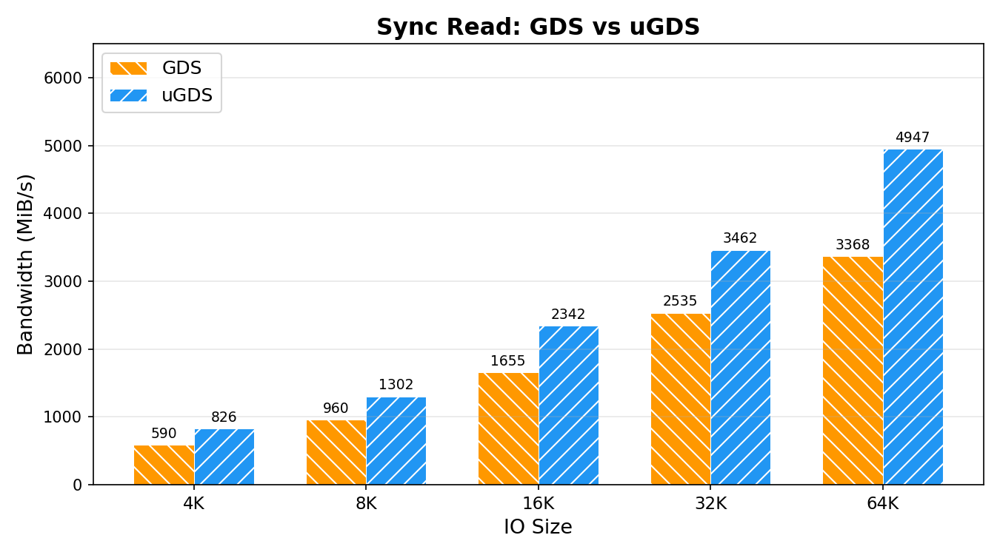
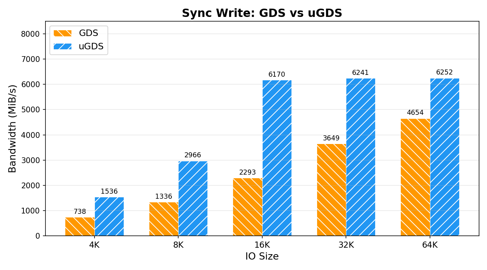
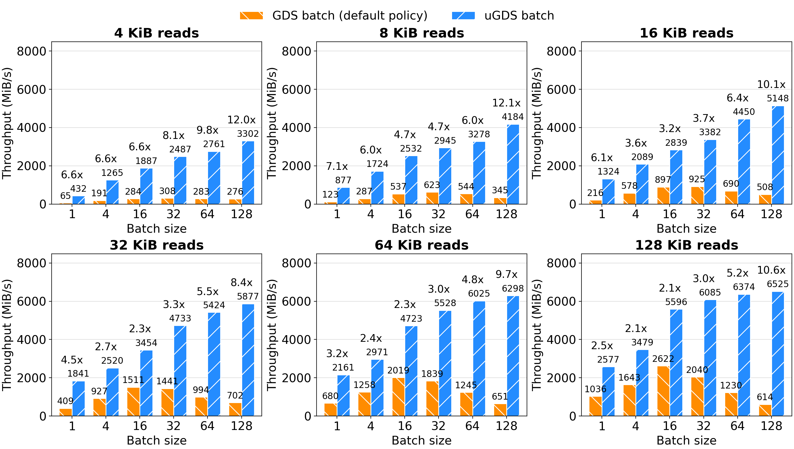
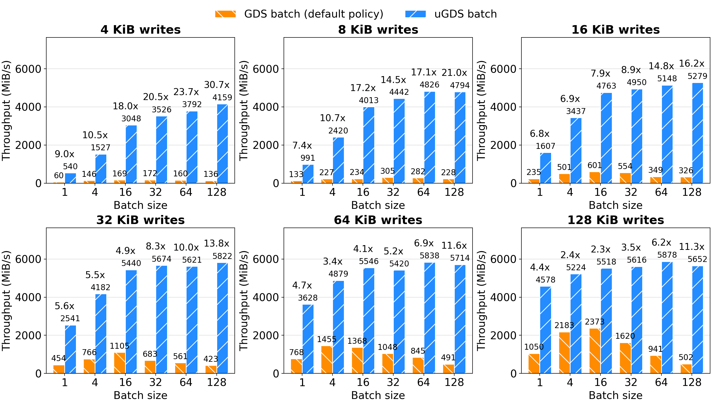

<p align="center">
  
</p>

<p align="center">
  <b>User-Space GPU Direct Storage Development Kit</b>
</p>

<p align="center">
  uGDS is the first production-oriented user-space GPU Direct Storage library where the CPU constructs NVMe commands and the SSD DMAs data directly to/from GPU memory over PCIe, bypassing the kernel NVMe driver. With a GDS-compatible API, uGDS achieves up to 30.69x higher bandwidth and 51.9% lower 4KB latency (37.56μs vs 78.01μs) compared to NVIDIA GDS.
</p>

---

<p align="center">
  <a href="https://github.com/LMCache/LMCache"></a>
  &nbsp;&nbsp;&nbsp;&nbsp;&nbsp;&nbsp;
  <a href="https://www.amd.com/en/products/software/rocm.html"></a>
  &nbsp;&nbsp;&nbsp;&nbsp;&nbsp;&nbsp;
  <a href="https://github.com/vllm-project/vllm"></a>
</p>

## News
- **2026-10**: We released the uGDS technical report: [arXiv](https://arxiv.org/abs/2610.30868), [Zhihu (Chinese)](https://zhuanlan.zhihu.com/p/2097033202187637385). 📄
- **2026-08** — We developed a backup solution for machines that do not support P2P DMA, providing a native disk-offloading path with zero external dependencies, and upstreamed it to vLLM. See [vLLM Disk Offloading](https://github.com/vllm-project/vllm/pull/49644)
- **2026-08** — The [uGDS adapter for LMCache](https://github.com/LMCache/LMCache/pull/4420) has landed upstream! Use uGDS as the GDS L1 backend on NVIDIA CUDA or AMD ROCm, then [try it with LMCache](https://github.com/LMCache/LMCache/blob/dev/docs/source/mp/configuration.rst#gds-l1-tier) by setting `--gds-l1-backend ugds`. 🚀
- **2026-07** — AMD Infinity Storage (HIP/ROCm) backend merged ([PR #1](https://github.com/ScaleX-IO/uGDS/pull/1)): dual-backend CUDA + HIP support. 🎉
- **2026-03** — CoPilotIO: CPU as a Co-pilot for GPU I/O to Free GPU Compute accepted to [OSDI '26](https://www.usenix.org/conference/osdi26/presentation/chen-guanyi). 🎓

## Key Features

- **User-space IO stack** — bypasses the kernel NVMe driver and filesystem entirely; CPU builds NVMe commands and polls completions in user space
- **cuFile API compatible** — existing GDS applications work with minimal changes (relink to `libugds.so`, change `cuFile` prefix to `uGDS`)
- **Multi-vendor GPU support** — NVIDIA CUDA and AMD Infinity Storage (HIP/ROCm) backends; both can be enabled simultaneously for mixed-GPU systems
- **DMA-buf export** -- export GPU memory as a Linux dma-buf file descriptor for RDMA, DPDK, and other dmabuf-aware subsystems
- **Fully open-source** — BSD 3-Clause licensed; no proprietary runtime dependencies beyond the GPU driver (NVIDIA driver or AMD ROCm runtime)
- **High performance** — busy-poll CQ completion with `_mm_pause()`, multi-queue round-robin IO, achieving up to 2.7x read and 28x write bandwidth over NVIDIA GDS
- **Interrupt mode (opt-in)** — MSI-X + eventfd completion for near-zero CPU utilization at large IO sizes; disabled by default (`UGDS_INTERRUPT_MODE=1` to enable)

## Architecture

```
┌────────────────────┐
│    Application     │    uGDSRead / uGDSWrite
│                    │    uGDSStorageCreate / AddHandle
└─────────┬──────────┘
          │
┌─────────▼──────────┐
│    libugds.so      │    Storage aggregation + NVMe command construction
│  Storage registry  │    SQ/CQ management for each registered handle
└────┬───────────┬───┘
     │           │       DMA: SSD ←→ GPU memory (P2P over PCIe)
┌────▼─────┐ ┌───▼─────┐
│ ugds_drv │ │ ugds_drv│    One independent handle per device
│  + SSD 0 │ │  + SSD 1│
└────┬─────┘ └───┬─────┘
     │           │
┌────▼─────┐ ┌───▼─────┐
│  NVMe 0  │ │  NVMe 1 │
└──────────┘ └─────────┘
```

The Storage API aggregates multiple independently registered handles and exposes their device count and aggregate capacity. Applications retrieve the handles by index and can issue concurrent per-device IO; automatic striping is a separate roadmap item. There is no kernel NVMe driver or page cache — the CPU only touches doorbell registers and completion queue entries.

## Performance

Test Platform: A100-40GB + Samsung 990 PRO (PCIe Gen4 x4)

12-thread sequential read and write bandwidth:





uGDS bypasses the kernel NVMe driver, achieving up to **1.47x** higher read bandwidth and **2.69x** higher write bandwidth than NVIDIA GDS at small IO sizes. For 4-KiB reads, uGDS cuts latency from 78.01 𝜇s (GDS) down to 37.56 𝜇s—a **51.9%** latency reduction.


The batch interfaces evaluation across transfer sizes (4--128,KiB) and logical batch sizes (QD 1--128) across a 64-MiB working set. 



uGDS outperforms GDS across all 36 evaluation points, delivering throughput gains ranging from **2.12x to 12.12x** for reads and **2.33x to 30.69x** for writes. The first
use cost of GDS batch mode is much higher than uGDS.

## Quick Start

```cpp
#include <ugds.h>
#include <cuda_runtime.h>

// 1. Initialize
uGDSDriverOpen();

// 2. Register device handle
int fd = open("/dev/ugds_drv0", O_RDWR);
uGDSDescr_t desc = {.type = UGDS_HANDLE_TYPE_OPAQUE_FD, .handle.fd = fd};
uGDSHandle_t fh;
uGDSHandleRegister(&fh, &desc);

// 3. Allocate and register GPU buffer
void* gpu_buf;
cudaMalloc(&gpu_buf, 4096);
uGDSBufRegister(gpu_buf, 4096, 0);

// 4. Direct GPU ←→ SSD transfer
uGDSWrite(fh, gpu_buf, 4096, /*file_offset=*/0, /*buf_offset=*/0);
uGDSRead(fh, gpu_buf, 4096, /*file_offset=*/0, /*buf_offset=*/0);

// 5. Cleanup
uGDSBufDeregister(gpu_buf);
uGDSHandleDeregister(fh);
uGDSDriverClose();
```

See [examples/01_basic_read_write.cu](examples/01_basic_read_write.cu) for a complete working example.

To aggregate multiple uGDS devices, register each device independently and add the handles to a Storage object:

```cpp
uGDSHandle_t fh0; // registered from /dev/ugds_drv0
uGDSHandle_t fh1; // registered from /dev/ugds_drv1

uGDSStorage_t storage;
uGDSStorageCreate(&storage);
uGDSStorageAddHandle(storage, fh0);
uGDSStorageAddHandle(storage, fh1);

uint32_t device_count;
uint64_t aggregate_capacity;
uGDSStorageGetDeviceCount(storage, &device_count);
uGDSStorageGetCapacity(storage, &aggregate_capacity);

// Retrieve handles by index for explicit per-device or concurrent IO.
uGDSHandle_t device0;
uGDSHandle_t device1;
uGDSStorageGetHandle(storage, 0, &device0);
uGDSStorageGetHandle(storage, 1, &device1);

uGDSStorageDestroy(storage);
```

For build instructions, environment setup, and driver management, see the **[Installation Guide](docs/installation.md)**.

Run the [vLLM + LMCache + uGDS end-to-end benchmark](examples/vllm_lmcache_bench/README.md) to validate KV-cache offloading on a dedicated NVMe SSD.

### AMD Infinity Storage (HIP/ROCm) Backend

To build with the AMD HIP backend instead of CUDA:

```bash
# Kernel module (HIP-only if NVIDIA source is present, add BUILD_CUDA=0)
cd drv && make BUILD_HIP=1 BUILD_CUDA=0

# Userspace library
mkdir build && cd build
cmake .. -DUGDS_BACKEND_HIP=ON -DUGDS_BACKEND_CUDA=OFF
make -j$(nproc)
```

Requires ROCm 7.0+, `CONFIG_HSA_AMD_P2P=y`, and Large BAR enabled. See the [Installation Guide](docs/installation.md) for details.

## Testing

```bash
# Run functional tests only
scripts/run_tests.sh functional

# Run uGDS performance benchmark
scripts/run_tests.sh perf

# Run uGDS vs GDS comparison (auto-switches driver mode)
scripts/run_tests.sh compare

# Run all (functional + comparison)
scripts/run_tests.sh all
```

The functional test suite includes `test_storage_multi_ssd`. It validates multi-device handle aggregation and concurrent reads, and skips with code `77` when a second uGDS device is unavailable.

For the dedicated multi-SSD performance benchmark, provide two distinct uGDS device paths explicitly:

```bash
build/bench_multi_ssd -f /dev/ugds_drv0 -F /dev/ugds_drv1 [-d 0] [-n 1024]
```

This benchmark validates storage aggregation and concurrent reads; it does not automatically stripe IO across devices.

## API Coverage

| API | Status | Notes |
|-----|:------:|-------|
| `uGDSDriverOpen / Close` | ✅ | |
| `uGDSHandleRegister / Deregister` | ✅ | Block device fd (no filesystem) |
| `uGDSBufRegister / Deregister` | ✅ | GPU memory only |
| `uGDSRead / Write` | ✅ | Synchronous, block-aligned |
| `uGDSBatchIOSetUp / Submit / GetStatus / Destroy` | ✅ | Submit/poll separation, up to 128 IOs per batch |
| `uGDSReadAsync / WriteAsync` | ✅ | CUDA stream integration, late-binding pointers |
| `uGDSStreamRegister / Deregister` | ✅ | Optional (no-op, uGDS has no bounce buffer) |
| `uGDSBufRegisterEx` | ✅ | Extended registration with backend selection and export flag |
| `uGDSExportDmabuf` | ✅ | DMA-buf fd export for RDMA and dmabuf-aware consumers |
| `uGDSStorageCreate / AddHandle / Get* / Destroy` | ✅ | Multi-device handle aggregation and capacity queries |

## Roadmap

| Phase | Description | Status |
|-------|-------------|--------|
| 1 | Core synchronous API + test suite | ✅ |
| 1.5 | Unified multi-backend (NVIDIA CUDA + AMD HIP/ROCm) | ✅ |
| 2 | Batch IO API (multi-command doorbell) | ✅ |
| 3 | Async Stream API (CUDA stream integration) | ✅ |
| 4 | Hugepage support (larger QP depth) | ✅ |
| 4.5 | Dual CUDA/HIP backend + DMA-buf export | ✅ |
| 5 | SGL support (scatter-gather lists) | 🔜 |
| 6 | Interrupt mode (MSI-X + eventfd) | ✅ |
| 7 | Multi-SSD support (multi-handle aggregation) | ✅ |
| 8 | Striping (automatic IO distribution across SSDs) | 🔜 |
| 9 | Filesystem compatibility (POSIX file path support) | 🔜 |
| 10 | [LMCache integration](https://github.com/ScaleX-IO/LMCache) (KV cache storage backend) | ✅ |

## Citation

If you find uGDS useful in your research, please cite our technical report:

```bibtex
@misc{wei2026ugdsuserspacedevelopmentkit,
      title={uGDS: A User-Space Development Kit for High-Performance GPU Direct Storage}, 
      author={Jing Wei and Guanyi Chen and Qi Chen and Chuyu Zhang and Zheng Zhou and Chutian Wang and Jian Zhang},
      year={2026},
      eprint={2610.30868},
      archivePrefix={arXiv},
      primaryClass={cs.DC},
      url={https://arxiv.org/abs/2610.30868}, 
}
```

uGDS originated from the motivation experiments in CoPilotIO:

```bibtex
@inproceedings{chen2026copilotio,
  title     = {CoPilotIO: CPU as a Co-pilot for GPU I/O to Free GPU Compute},
  author    = {Guanyi Chen and Qi Chen and Shu Yin and Jian Zhang},
  booktitle = {Proceedings of the 20th USENIX Symposium on Operating Systems Design and Implementation (OSDI '26)},
  year      = {2026}
}
```

## References

- [ssd-gpu-dma](https://github.com/enfiskutensykkel/ssd-gpu-dma) — User-space NVMe driver with GPU support
- [BaM](https://github.com/ZaidQureshi/bam) — Big accelerator Memory, GPU-orchestrated NVMe access
- [Phoenix](https://github.com/xPU-IO/phoenix) — GPU Direct Storage Optimization

## Contact

- Guanyi Chen — felixlinker02@gmail.com — [chengy-sysu.github.io](https://chengy-sysu.github.io)
- Jian Zhang — jianz@hkust-gz.edu.cn — [sosp.dev](https://sosp.dev)

Join the community on **[Slack](https://join.slack.com/t/scalex-io/shared_invite/zt-4dtq5uxn9-gefCZJOuXIgl_QGCITkUGw)** or **WeChat**:

<table>
  <tr>
    <th>Slack</th>
    <th>WeChat</th>
  </tr>
  <tr>
    <td align="center"><a href="https://join.slack.com/t/scalex-io/shared_invite/zt-4dtq5uxn9-gefCZJOuXIgl_QGCITkUGw"></a></td>
    <td align="center"></td>
  </tr>
</table>

## License

BSD 3-Clause License. See [LICENSE](LICENSE).
